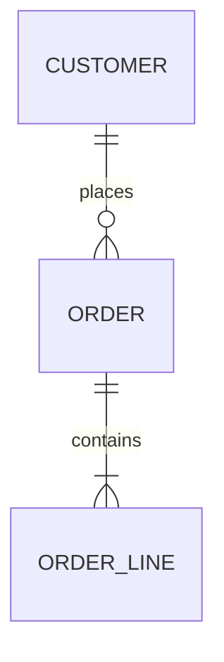
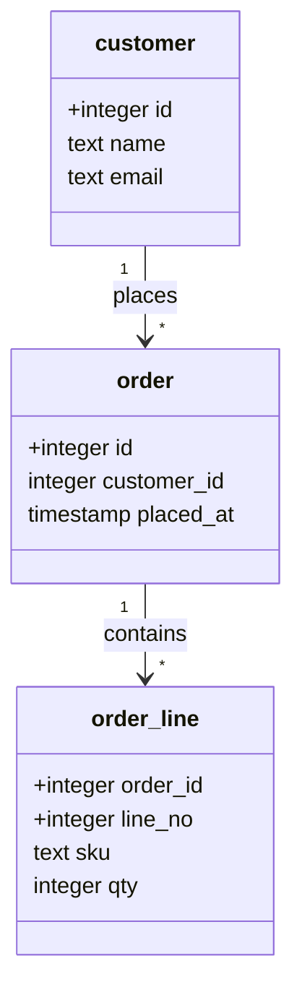
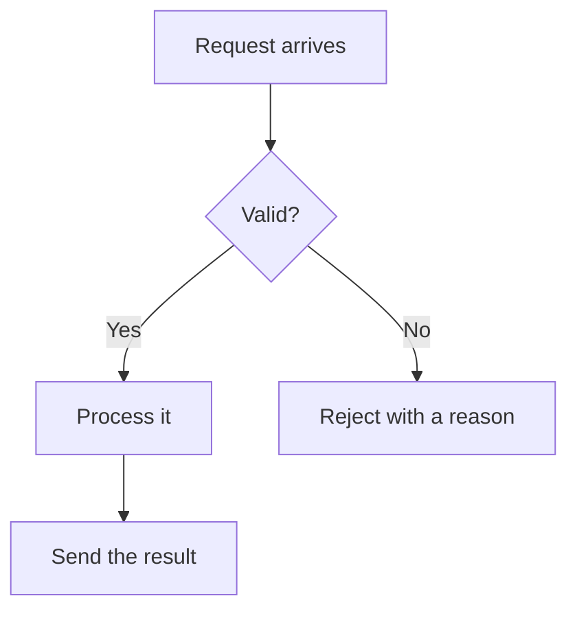

# Markdown Lab

*Useful patterns, then how Markdown Lab follows your attention.*

## What Markdown Lab is

Markdown Lab is a simple editor for markdown files on your own computer. You open a file, write in plain text on the left, and see it formatted on the right as you type. Save puts your changes straight back into the same file. Nothing is uploaded anywhere: the app runs entirely in your browser, and your files stay where they are.

Each open file gets its own tab. You can hide the writing side to read, or hide the formatted side to write, switch between a dark and a light look, and export any document as a PDF.

## Useful patterns

Ready-made shapes for organising a document. Each one is written live, so the source is on the left and the result on the right — copy whatever you need. They all use standard markdown, so they look the same in VS Code and on GitHub; the few Markdown Lab extras are marked.

**Nesting:** press **Tab** to indent a line (four spaces) and **Shift+Tab** to bring it back. A line nests under an item when it starts where the item's text starts — Tab always gets you there.

### Headings and emphasis

Start a line with `#` for a title, `##` for a section, `###` for a subsection — down to six levels.

Write **bold** with two stars, *italic* with one, ~~struck through~~ with two tildes, and `code` between backticks. A [link](https://commonmark.org) is the text in brackets and the address in parentheses. A line with only `---` draws a rule.

---

### A to-do list

- [x] Write the outline
- [x] Collect the numbers
- [ ] Draft the summary
    - [ ] Check the figures with finance
    - [ ] Add the chart
- [ ] Send for review

Numbered steps can be to-dos too, and keep their number:

1. [x] Book the room
2. [ ] Send the invitation
3. [ ] Print the agenda

### A workflow as nested steps

1. **Prepare**
    - Pull the latest data
    - Check it for gaps
2. **Process**
    1. Clean the records
    2. Join the two sources
        - match on customer id
        - keep unmatched rows for review
    3. Compute the totals
3. **Publish**
    - Export the report as a PDF
    - Share the link

### An outline with numbered labels (Markdown Lab extra)

Start a bullet with a label in braces and it becomes the marker. Elsewhere it reads as a plain bullet that starts with the label.

- {1} Context
    - {1.1} Goals
    - {1.2} Non-goals
- {2} Design
    - {2.1} Data model
    - {2.2} Rollout

### Describing database tables

A table gives the overview:

| Table | Holds | Key |
|---|---|---|
| `customer` | One row per customer | `id` |
| `order` | One row per order | `id` |
| `order_line` | One row per product in an order | `order_id`, `line_no` |

A nested list gives each table's columns:

- **`customer`**
    - `id` — integer, primary key
    - `name` — text, required
    - `email` — text, unique
- **`order`**
    - `id` — integer, primary key
    - `customer_id` — integer, references `customer.id`
    - `placed_at` — timestamp

And the exact schema goes in a code block:

```sql
CREATE TABLE customer (
    id    INTEGER PRIMARY KEY,
    name  TEXT NOT NULL,
    email TEXT UNIQUE
);

CREATE TABLE "order" (
    id          INTEGER PRIMARY KEY,
    customer_id INTEGER NOT NULL REFERENCES customer (id),
    placed_at   TIMESTAMP NOT NULL
);
```

A diagram shows how they relate:



### Tables as UML-style blocks

The same tables, one code block each, written like UML classes: the name, a rule, then one line per column — `+` marks the key, braces hold the rules. Code blocks keep every space, so the columns stay lined up.

```uml
customer
─────────────────────────────────
+ id        : integer   {PK}
  name      : text      {not null}
  email     : text      {unique}
```

```uml
order
─────────────────────────────────
+ id          : integer    {PK}
  customer_id : integer    {FK → customer.id}
  placed_at   : timestamp  {not null}
```

```uml
order_line
─────────────────────────────────
+ order_id : integer  {PK, FK → order.id}
+ line_no  : integer  {PK}
  sku      : text     {not null}
  qty      : integer  {> 0}
```

Mermaid draws the same idea as real UML boxes, with the links between them:



### A flowchart



Write `flowchart LR` instead of `TD` to run it left to right.

### Math

Inline, between single dollar signs: the area of a circle is $A = \pi r^2$. Prices are safe — "$5 and $10" stays as text.

On its own line, between double dollar signs:

$$
\sum_{i=1}^{n} i = \frac{n(n+1)}{2}
$$

### Code

Wrap code in three backticks, and name the language after the first three — the preview colours it (Python, TypeScript, JSON, SQL, Bash and hundreds more):

```python
from dataclasses import dataclass


@dataclass
class Order:
    item: str
    amount: float
    paid: bool = False


def total(orders: list[Order], paid_only: bool = True) -> float:
    """Sum the orders, by default only the paid ones."""
    return sum(o.amount for o in orders if o.paid or not paid_only)


print(f"Total: {total([Order('pen', 0.8, True)]):.2f}")
```

```typescript
interface Order {
  item: string
  amount: number
  paid?: boolean
}

// Sum the orders, by default only the paid ones.
export function total(orders: Order[], paidOnly = true): number {
  return orders
    .filter((o) => o.paid || !paidOnly)
    .reduce((sum, o) => sum + o.amount, 0)
}

console.log(`Total: ${total([{ item: 'pen', amount: 0.8, paid: true }]).toFixed(2)}`)
```

Write `inline code` between single backticks.

### Tables

Colons in the line under the header align a column: left, centre or right.

| Item | Qty | Price |
|:---|:---:|---:|
| Notebook | 2 | 3.50 |
| Pen | 10 | 0.80 |
| **Total** | | **15.00** |

### Callouts

A quote whose first line is `[!NOTE]`, `[!TIP]`, `[!IMPORTANT]`, `[!WARNING]` or `[!CAUTION]` becomes a coloured callout, as on GitHub:

> [!TIP]
> Keep one idea per section; the focus and the reader both thank you.

> [!WARNING]
> Changing the order format breaks older exports.

An ordinary quote:

> Plain quotes are for words that someone else said.

### A decision record

A small skeleton for writing down a decision:

> **Decision:** store totals as integer cents.
>
> - **Why:** sums stay exact; no rounding drift.
> - **Instead of:** decimal columns, which our reporting tool rounds.
> - **Follow-up:** convert the two old reports by Friday.

# Focus

*How Markdown Lab follows your attention, and how we built it.*

## What this part is

This part is about one feature of the editor: the **focus**. As you move through your text, a field of attention follows your cursor, and the formatted side underlines the stretch of text that holds most of it. It is a quiet record of what you are reading or writing, and the groundwork for future features that look at your text alongside you.

It does two things at once.

**It explains how the focus works.** We start with the idea, then build it up piece by piece:

- the four sizes of text it pays attention to — words, sentences, paragraphs and sections;
- the single ruler, counted in words, that lets those sizes be compared;
- the field of attention around the focal point, and how each piece of text gets its share;
- why the focus is the stretch holding 60% of the attention;
- the two controls, decay and lag, and why decay is tuned per scale;
- how the underline is drawn, and how fast all of it runs.

**It shows the behaviour as you read.** The sections are written in deliberately different shapes:

- runs of tiny sentences, and runs of sentences that go on for a long time;
- lists of single words, and lists of whole paragraphs;
- sections nested inside sections.

Each shape makes the focus behave differently. Over short sentences the underline stretches across many of them; over long ones it shrinks to one or two. Over a list of single words it covers a whole column; over a deep heading it jumps a section at a time. Section 9, at the end, is a playground made only of these shapes.

**To follow along:** open this file in Markdown Lab, turn the focus on — it starts off: click the **Focus** button at the top right of the Preview, then the eye in the panel that drops down, and move your cursor through the text. Try changing the scale between Words, Sentences, Paragraphs and Sections, and nudge the Decay and Lag sliders as you go — the counter on the right says how many units are in focus. Lag starts at 0, with the focus following your cursor live; raise it and the focus trails your path a few steps behind.

## 1. The idea in one breath

You read. Your cursor moves. Your attention is not a point. It is a field. It is strongest at one spot. It fades with distance. Near things get more of it. Long things get less of it. The focus is the stretch that holds most of it. It sits at your cursor. Or a few steps behind it, along the way you came. It works at four sizes. Words. Sentences. Paragraphs. Sections.

## 2. Four sizes of attention

Text is not one long string; it is nested. Words sit inside sentences, sentences inside paragraphs, paragraphs inside sections, and each of those is a different size of thing that you can be focused on. The focus works at each of the four sizes, and you choose which one the preview underlines.

### 2.1 Words

The smallest unit. Every word counts the same:

- short
- medium
- extraordinarily
- a
- antidisestablishmentarianism

A long word is not harder to focus on than a short one. You take a word in at a glance, whatever its length. So on the word scale, each word is exactly one unit wide.

### 2.2 Sentences

Here length starts to matter, because a sentence is not taken in at a glance but followed from its first word to its last, and the longer it runs — the more clauses it strings together, the more qualifications it stacks up before it finally reaches its point — the more of your attention it needs before you can let it go and move on to the next one. A short one does not. You read it and you are done.

### 2.3 Paragraphs

The same is true one level up, and paragraphs can be long in two different ways:

- **Many short sentences.** A paragraph can be long because it has many sentences. Each one is easy. There are just a lot of them. You can lose your place among them.

- **A few long sentences.** A paragraph can also be long because its sentences are long, each one carrying a full idea with all of its conditions and exceptions attached, so that even two or three of them fill as much space as a dozen short ones would, and ask for a different kind of attention.

- **Both.** Most real paragraphs mix the two. The focus measures every paragraph by its words, so a paragraph's length is the same whichever way it got long.

### 2.4 Sections

A section is everything under a heading, down to the next heading of any level. This document has nested sections — this one, 2.4, lives inside section 2 — and each one is a unit on the section scale. Move your cursor from heading to heading with the scale set to *Sections* and the underline jumps a whole section at a time.

## 3. The ruler

To compare things of different sizes, we need one ruler for all of them. The ruler is the word.

1. Number every word in the document: 0, 1, 2, and so on.
2. Word number *i* occupies the stretch from *i* to *i + 1* on the ruler.
3. A sentence occupies the stretch of its words. A ten-word sentence is ten units long.
4. A paragraph and a section occupy the stretch of all their words.
5. Your cursor sits on the ruler too — inside a word, it sits part of the way through it.

Punctuation, list bullets and markdown symbols are not words, so they take up no room on the ruler. Code blocks count as a single sentence each.

## 4. The attention field

### 4.1 A field emitted from the focal point

The **focal point** sits on the ruler and emits a field of attention: a bell curve that peaks at 1 right at the focal point and fades on either side.

$$ b(x) = e^{-\frac{(x - x_0)^2}{2\sigma^2}} $$

Here $x_0$ is the focal point and $\sigma$ is the field's **decay**: how many words it takes for attention to fade. A small decay is a tight beam; a large one spreads wide. The field is the same everywhere — at a word, a sentence or a section, it is this one equation, read off the word ruler.

### 4.2 A unit's attention is the field's average over it

Every word, sentence, paragraph and section gets a share of attention: the **average** height of the field across its length.

There were two ways to measure it, and the choice matters:

- **Area under the curve** adds up the field over the unit's length. A longer unit collects more, so long sentences would take *more* attention than short ones. That is not how attention feels.
- **Average over the unit** divides that area by the length. A unit gets less attention when it is farther away *and* when it is longer, because a long unit stretches out over the field's fading slopes.

The focus uses the average. It has an exact formula — two lookups of the bell's area — so no letter-by-letter loop is ever needed.

### 4.3 What is in focus: 60% of the attention

Add up the attention of every unit at the chosen scale. The **focus** is the smallest unbroken run of units, starting from the one under the focal point, that holds **60%** of that total. It grows outward one unit at a time, always taking whichever neighbour — left or right — gets more attention, until it holds 60%.

Because the cut is a share of the total rather than a fixed height on the curve, the focus always means the same thing: the part of the text that holds most of your attention right now.

### 4.4 A worked example

Set the decay to 15 words and put the focal point in the middle of a sentence. Compare two neighbourhoods.

When the sentences are short, four words each, attention falls off slowly from one sentence to the next:

- the focal sentence gets 1.00
- the next one out, 0.96
- then 0.87
- then 0.73
- then 0.57, 0.41, 0.28…

Seven sentences — three on each side — hold 60% of the total, so seven are underlined.

When the sentences are long, twenty words each, the focal sentence gets 0.93, the next one only 0.43, and the one after 0.04. The focal sentence and one neighbour already hold 60%, so two are underlined.

Same decay, same focal point. The difference is entirely how long the sentences are.

## 5. Decay, tuned per scale

Decay is measured in words, and each scale remembers its own. A decay that underlines a handful of words would underline a single sentence and nothing at all beyond its own section, so each scale needs its own setting:

| Scale | Default decay | Typically in focus |
|---|---|---|
| Words | 1 word | 2 words |
| Sentences | 12 words | 2–3 sentences |
| Paragraphs | 30 words | about 3 paragraphs |
| Sections | 150 words | about 3 sections |

The decay slider is logarithmic, so each notch changes the field by the same proportion, whether it is 2 words wide or 2,000. The counter under the Preview heading shows how many units are in focus right now, so you can tune each scale by eye.

## 6. Lag: following your path

The focal point follows the path your cursor has taken, a set number of steps behind. That number is the **lag**, and a step is one unit of the scale you are viewing:

1. At lag 0, the focal point is the cursor itself: the focus follows you live.
2. The app remembers the last units your cursor has been in, in the order you visited them. Moving around inside one sentence is still one step; moving into the next sentence is a new step.
3. At lag 2 on the Sentences scale, the focal point sits in the sentence you were in two sentences ago. On Words it is two words ago; on Paragraphs, two paragraphs ago.
4. It follows the path, not the page. If you jump from the top of the document to the bottom, the focus stays at the top for a couple of steps, then catches up.
5. Inside that unit, the focal point is where your cursor last was when you were there.
6. Until you have made enough moves, it sits on the oldest place it remembers.

## 7. Following the cursor

The focus engine does not keep anything per tab. Instead:

- when you move the cursor or select text, the step is added to the path, and the focal point and the focus are recomputed;
- when you switch to another tab, that tab's text is re-indexed and the path starts fresh;
- when you type, the index is rebuilt once you pause for a moment, so typing stays smooth even in very large files.

### 7.1 Drawing the underline

The cursor lives in the markdown source, but the underline is drawn in the rendered preview, so the two have to be matched up. The engine lines up the words of the source with the words of the preview, in order. Markup that only exists on one side — the address inside a [link](https://example.com), the commands inside a formula — is simply skipped. Then the browser's built-in text highlighting draws a plain underline from the first word of the focus to the last, without changing the preview at all.

### 7.2 How fast it is

On a document of a hundred thousand words, re-indexing after a pause in typing takes about **330 milliseconds**. Each cursor move only looks at the units the field actually reaches, about **10 microseconds** on this guide. The underline is redrawn at most once per screen refresh.

## 8. What it is for

The underline is not decoration. It is the visible face of a set of numbers: for every unit near the focal point, at every scale, a share of attention between 0 and 1. Those shares, and the stretch of text they cover, are what a future AI step can read — a pointer that says *look here, at this window of text, this much*. With a lag, that pointer settles on what you have just read, rather than chasing every keystroke.

## 9. Playground

The sections below exist only to be moved through. Try each one at each scale, and at a few decays.

### 9.1 A run of tiny sentences

Go. Stop. Look. Wait. Read on. Turn back. Try again. Now slow. Now fast. Breathe. Keep going. Almost there. Done.

### 9.2 A run of long sentences

This sentence is long on purpose, stretching out across the line so that the bell curve has to reach a long way to cover it, which pulls its average attention down. The next one does the same thing, adding clause after clause and detail after detail, so that it too sits mostly on the lower slopes of the curve. And this third one completes the set, long enough that even a generous decay can only hold one or two of them in focus at a time.

### 9.3 A list of single words

- alpha
- bravo
- charlie
- delta
- echo
- foxtrot
- golf
- hotel

### 9.4 A list of paragraphs

1. **The first item is a paragraph.** It has three sentences. Each is short.

2. **The second item is a longer paragraph,** made of fewer but fuller sentences, each one carrying more words, so that, counted in words, it is longer than the first even though it has fewer sentences.

3. **The third item is short.** Just two sentences.

### 9.5 Nested all the way down

#### 9.5.1 A small section

One paragraph. Two short sentences.

#### 9.5.2 Another small section

Also small. With a list:

- one
- two

##### 9.5.2.1 Deeper still

The deepest section in this document. Move between the headings here with the scale set to *Sections* and watch the underline step from one to the next.

### 9.6 A mix

A short sentence. Then a much longer one that wanders on for a while before it finally makes its point, and only then lets you go. Short again.

- a list in the middle of it all
- with a second item that runs on a little longer than the first one does

And a closing paragraph, back to normal length, to finish the tour.
