# Markdown Renderer Test Fixture

This file is a single fixture of test cases for a markdown renderer. Scope: English text only, CommonMark + GFM (tables, task lists, strikethrough, autolinks, alerts), LaTeX math (`$...$` and `$$...$$`), and Mermaid. No raw HTML tests.

**Conventions**

- Every case starts with a heading of the form `### [ID] description`. To extract cases, split on the regex `^### \[[A-Z]+-\d{3}\]`.
- Everything between two case headings is the test input and is written as live markdown so you can eyeball the render.
- Some cases are intentionally malformed or ambiguous. Those are marked `(EDGE)` or `(INVALID)` in the description. Decide what the expected output is for them and snapshot it.
- Cases marked `(EXT)` use non-CommonMark syntax (GFM, math, alphanumeric lists). Decide whether your renderer supports them.

---

## 1. Headings

### [HDG-001] ATX levels 1 to 6

# Heading level 1
## Heading level 2
### Heading level 3
#### Heading level 4
##### Heading level 5
###### Heading level 6

### [HDG-002] Setext headings

Setext level 1
==============

Setext level 2
--------------

Setext with multiple words and *emphasis*
=========================================

### [HDG-003] Closing hashes

## Closed heading ##

### Closed with many hashes ######

#### Closing hashes with trailing spaces ####   

### [HDG-004] No space after hash (EDGE)

#NoSpaceHeading

#hashtag in a paragraph

### [HDG-005] Seven hashes (EDGE)

####### Seven hashes is not a heading

### [HDG-006] Inline formatting in headings

## Heading with *emphasis*, **bold**, `code`, and [a link](https://example.com)

## Heading with ~~strike~~ and math $x^2$

### [HDG-007] Heading directly after a paragraph (no blank line)

Paragraph text right before
# Heading with no blank line before
Paragraph text right after

### [HDG-008] Duplicate heading text (anchor collisions)

## Duplicate

Content under the first.

## Duplicate

Content under the second.

## Duplicate

Content under the third.

### [HDG-009] Punctuation and symbols in heading text

## What's new? (v2.0) - C++ & more!

## 1. Numbered heading

## API: `POST /v1/items/{id}`

### [HDG-010] Empty headings (EDGE)

#

##

Text after empty headings.

### [HDG-011] Heading with leading spaces

 # One leading space

  ## Two leading spaces

   ### Three leading spaces

    #### Four leading spaces (code block)

---

## 2. Paragraphs and line breaks

### [PAR-001] Soft line breaks

This is line one of the paragraph.
This is line two of the same paragraph.
This is line three of the same paragraph.

### [PAR-002] Hard line break with two trailing spaces

Line one ends with two spaces.  
Line two follows after a hard break.  
Line three follows after a hard break.

### [PAR-003] Hard line break with backslash

Line one ends with a backslash.\
Line two follows after a hard break.\
Line three follows after a hard break.

### [PAR-004] Multiple blank lines between paragraphs

Paragraph one.


Paragraph two after three blank lines.

### [PAR-005] Leading indentation of 1 to 3 spaces

 One space indent.

  Two spaces indent.

   Three spaces indent.

### [PAR-006] Long paragraph wrapping

Lorem ipsum dolor sit amet, consectetur adipiscing elit, sed do eiusmod tempor incididunt ut labore et dolore magna aliqua. Ut enim ad minim veniam, quis nostrud exercitation ullamco laboris nisi ut aliquip ex ea commodo consequat. Duis aute irure dolor in reprehenderit in voluptate velit esse cillum dolore eu fugiat nulla pariatur. Excepteur sint occaecat cupidatat non proident, sunt in culpa qui officia deserunt mollit anim id est laborum.

### [PAR-007] Hard break at end of paragraph (EDGE)

Trailing two spaces at the very end of a paragraph.  

Next paragraph.

### [PAR-008] Backslash at end of paragraph (EDGE)

Trailing backslash at the very end of a paragraph\

Next paragraph.

---

## 3. Thematic breaks

### [HR-001] Dash, asterisk, underscore

Above

---

Between one

***

Between two

___

Below

### [HR-002] Spaced and long variants

- - -

* * *

_ _ _

----------

**********

### [HR-003] Too short (EDGE)

--

**

__

### [HR-004] Directly after a paragraph (setext conflict)

This line becomes a setext H2
---

This line does not, because of the blank line above the rule

---

### [HR-005] Between list items and after list

- item one
- item two

---

- item three

***

1. ordered one
2. ordered two

___

---

## 4. Blockquotes

### [BQ-001] Single-line quote

> A single-line blockquote.

### [BQ-002] Multi-paragraph quote

> First paragraph of the quote.
>
> Second paragraph of the quote.
>
> Third paragraph of the quote.

### [BQ-003] Nested quotes, 4 levels

> Level one
>
> > Level two
> >
> > > Level three
> > >
> > > > Level four
> > >
> > > Back to level three
> >
> > Back to level two
>
> Back to level one

### [BQ-004] Lazy continuation

> This quote has a first line
and a lazy second line without the marker
and a lazy third line.

Paragraph after the quote.

### [BQ-005] Quote containing heading, list, code

> ## Quoted heading
>
> - bullet one
> - bullet two
>
> ```python
> def quoted():
>     return "code inside a quote"
> ```
>
> 1. ordered one
> 2. ordered two

### [BQ-006] Quote containing a table

> | Name  | Value |
> |-------|-------|
> | alpha | 1     |
> | beta  | 2     |

### [BQ-007] Quote containing mermaid

> ```mermaid
> flowchart LR
>     A[Start] --> B{Decision}
>     B -->|yes| C[Do it]
>     B -->|no| D[Skip it]
> ```

### [BQ-008] Two quotes separated by a blank line

> Quote one.

> Quote two (separate blockquote).

### [BQ-009] Empty quote (EDGE)

>

>
> 

### [BQ-010] Quote with no space after marker

>no space after the marker
>
>>nested no space

### [BQ-011] Nested quote with list with nested quote

> - item one
>   > quote inside item one
> - item two
>   > quote inside item two
>   >
>   > - list inside quote inside item two

---

## 5. Alerts (EXT: GFM alerts)

### [ALERT-001] All five types

> [!NOTE]
> Useful information that users should know.

> [!TIP]
> Helpful advice for doing things better.

> [!IMPORTANT]
> Key information users need to know.

> [!WARNING]
> Urgent info that needs immediate attention.

> [!CAUTION]
> Advises about risks or negative outcomes.

### [ALERT-002] Multi-paragraph alert

> [!NOTE]
> First paragraph of the note.
>
> Second paragraph of the note with **bold** and `code`.

### [ALERT-003] Alert containing list and code

> [!WARNING]
> Before deploying:
>
> 1. Run the migrations
> 2. Verify the config
>
> ```bash
> ./deploy.sh --dry-run
> ```

### [ALERT-004] Unknown alert type (EDGE)

> [!FOOBAR]
> This type does not exist.

### [ALERT-005] Lowercase and spacing variants (EDGE)

> [!note]
> Lowercase type.

> [! NOTE]
> Space inside the brackets.

> [!NOTE] Text on the same line as the marker.

### [ALERT-006] Alert inside a list item

- Item with an alert:

  > [!TIP]
  > Tip inside a list item.

- Next item.

### [ALERT-007] Alert with no content (EDGE)

> [!NOTE]

---

## 6. Emphasis and inline formatting

### [EMP-001] Basic emphasis

*asterisk emphasis* and _underscore emphasis_

**asterisk strong** and __underscore strong__

***asterisk both*** and ___underscore both___

### [EMP-002] Nested and mixed

**bold with *nested italic* inside**

*italic with **nested bold** inside*

***bold-italic with `code` inside***

**bold _with underscore italic_ inside**

### [EMP-003] Intraword markers

snake_case_identifier is not emphasized

snake*case*asterisk is emphasized

a__b__c double underscores intraword

foo*bar*baz

### [EMP-004] Unbalanced and unmatched (EDGE)

*unclosed emphasis

**unclosed strong

closed* with only a closer

2 * 3 * 4 is arithmetic, not emphasis

a * b * c with spaces

### [EMP-005] Escaped markers

\*not emphasis\*

\_not emphasis\_

\*\*not strong\*\*

### [EMP-006] Adjacent to punctuation

**"quoted bold"**

*(parenthesized italic)*

**bold.** Next sentence.

*italic,* followed by a comma.

### [EMP-007] Emphasis spanning lines

*emphasis that starts on this line
and ends on the next line*

**strong that starts here
and ends on the next line**

### [EMP-008] Rule of three edge cases (EDGE)

***a** b*

***a* b**

**a *b* c**

*a **b** c*

### [EMP-009] Emphasis with spaces inside (EDGE)

* not emphasis *

** not strong **

_ not emphasis _

### [STR-001] Strikethrough (EXT)

~~strikethrough text~~

~~strike with **bold** inside~~

**bold with ~~strike~~ inside**

### [STR-002] Strikethrough edge cases (EXT, EDGE)

~single tilde~

~~unclosed strike

~~strike across
two lines~~

Text before ~~~triple tilde inline~~~ text after (mid-line, so not a fence)

---

## 7. Inline code

### [ICODE-001] Basic inline code

Use `printf("hello")` to print.

Inline `code` with `multiple` `spans` in one line.

### [ICODE-002] Backticks inside code

`` code with ` a backtick ``

``` code with `` two backticks ```

`` `leading and trailing backticks` ``

### [ICODE-003] Space stripping

` single space padded `

`  two spaces padded  `

`` ` ``

### [ICODE-004] Markdown characters inside code

`**not bold** and _not italic_ and [not a link](url)`

`# not a heading` and `- not a list` and `> not a quote`

`<div>` and `&amp;` and `\n`

### [ICODE-005] Long inline code wrapping

`this_is_a_very_long_inline_code_span_that_has_no_spaces_and_may_overflow_its_container_if_the_renderer_does_not_handle_wrapping_or_scrolling_correctly_at_all`

`this is a long inline code span that has spaces and should be allowed to wrap across multiple lines when the container is narrow enough to require it`

### [ICODE-006] Unclosed and empty (EDGE)

`unclosed backtick

``mismatched backtick count`

` `

### [ICODE-007] Code spanning lines

`code that starts here
and ends on the next line`

---

## 8. Links

### [LNK-001] Inline links

[plain link](https://example.com)

[link with title](https://example.com "Example Title")

[link with single-quote title](https://example.com 'Example Title')

[link with paren title](https://example.com (Example Title))

### [LNK-002] Reference links

[full reference][ref-one]

[collapsed reference][]

[shortcut reference]

[Case Insensitive][REF-ONE]

[ref-one]: https://example.com/one "Reference One"
[collapsed reference]: https://example.com/collapsed
[shortcut reference]: https://example.com/shortcut

### [LNK-003] Reference defined before use

[defined-first]: https://example.com/first

Link to [defined-first] appears after its definition.

### [LNK-004] Undefined reference (EDGE)

[undefined reference][nope]

[also undefined]

### [LNK-005] Autolinks

<https://example.com>

<https://example.com/path?query=1&other=2#fragment>

<mailto:someone@example.com>

<someone@example.com>

### [LNK-006] Bare URLs (EXT: GFM autolink literal)

Visit https://example.com for more.

Visit www.example.com for more.

Email someone@example.com for more.

Trailing punctuation: https://example.com/path.

Trailing paren: (see https://example.com/path)

### [LNK-007] Relative and anchor links

[relative path](./docs/design.md)

[parent path](../README.md)

[root path](/docs/index.md)

[anchor link](#links)

[cross-file anchor](./other.md#section)

[query string](https://example.com/search?q=markdown&page=2)

### [LNK-008] Formatting inside link text

[**bold link**](https://example.com)

[*italic link*](https://example.com)

[`code link`](https://example.com)

[link with ~~strike~~ and **bold** and `code`](https://example.com)

### [LNK-009] Special characters in destinations

[angle brackets](<https://example.com/with space>)

[parens in url](https://example.com/wiki/Foo_(bar))

[escaped paren](https://example.com/a\)b)

[empty destination]()

[fragment only](#)

### [LNK-010] Nested and adjacent (EDGE)

[outer [inner] brackets](https://example.com)

[link one](https://example.com/1)[link two](https://example.com/2)

[text](https://example.com)(not part of the link)

 is not a link

### [LNK-011] Links across lines

[link text that starts here
and continues on the next line](https://example.com)

### [LNK-012] Unclosed link syntax (EDGE)

[unclosed bracket

[text](unclosed paren

[text]( https://example.com with spaces )

---

## 9. Images

### [IMG-001] Inline images


### [IMG-002] Reference images

![reference image][img-ref]

![collapsed][]

[img-ref]: https://example.com/ref.png "Ref Title"
[collapsed]: https://example.com/collapsed.png

### [IMG-003] Linked image

[](https://example.com)

[](https://example.com/1) [](https://example.com/2)

### [IMG-004] Relative paths


### [IMG-005] Broken image (EDGE)


### [IMG-006] Image in various contexts

Inline in a sentence  with text after it.

- List item with image 

> Quote with image 

| Col | Image |
|-----|-------|
| a   |  |

### [IMG-007] Alt text with formatting (EDGE)


![alt with [brackets]](https://example.com/image.png)

---

## 10. Escapes and entities

### [ESC-001] Backslash escapes

\\ \` \* \_ \{ \} \[ \] \( \) \# \+ \- \. \! \| \< \>

### [ESC-002] Escapes that should be literal backslashes

\a \b \c \1 \2 \3

C:\Users\name\file.txt

### [ESC-003] Escaped at line start

\# not a heading

\- not a list

\> not a quote

1\. not an ordered list

\+ not a list

### [ESC-004] Named and numeric entities

&amp; &lt; &gt; &quot; &copy; &mdash; &nbsp; &hellip;

&#35; &#x23; &#65; &#x41;

### [ESC-005] Invalid entities (EDGE)

&notanentity; &#xyz; &amp

AT&T and R&D are plain text

### [ESC-006] Entities inside code (must stay literal)

`&amp; &lt; &copy;`

```
&amp; &lt; &copy;
```

### [ESC-007] Special characters in plain text

Less-than < and greater-than > and ampersand & in prose.

5 < 10 and 10 > 5 and 3 & 4.

---

## 11. Math (EXT: LaTeX)

### [MATH-001] Inline math

The equation $E = mc^2$ is famous.

Inline with fraction $\frac{a}{b}$ and root $\sqrt{x^2 + y^2}$ in one sentence.

Greek letters: $\alpha$, $\beta$, $\gamma$, $\Delta$, $\Omega$.

### [MATH-002] Block math

$$
\int_{-\infty}^{\infty} e^{-x^2} \, dx = \sqrt{\pi}
$$

### [MATH-003] Single-line block math

$$ a^2 + b^2 = c^2 $$

### [MATH-004] Dollar signs in prose (EDGE)

The price is $5 and the other price is $10.

It costs $5.00, not $50.

Cash: $100, $200, $300 are amounts.

### [MATH-005] Escaped dollar signs

\$5 and \$10 are escaped dollars.

Mix: \$5 costs and $x + y$ is math.

### [MATH-006] Markdown-sensitive characters inside math

$a_1 + a_2 * b_3 + c_4$

$x_i * y_i * z_i$

$[a, b)$ and $(a, b]$ intervals

$a \| b$ and $a \\ b$

### [MATH-007] Multi-line aligned environment

$$
\begin{aligned}
f(x) &= (x + 1)^2 \\
     &= x^2 + 2x + 1 \\
f'(x) &= 2x + 2
\end{aligned}
$$

### [MATH-008] Matrices

$$
A = \begin{pmatrix}
a_{11} & a_{12} \\
a_{21} & a_{22}
\end{pmatrix}
\qquad
\det(A) = a_{11}a_{22} - a_{12}a_{21}
$$

### [MATH-009] Sums, products, limits

$$
\sum_{i=1}^{n} i = \frac{n(n+1)}{2}
\qquad
\prod_{k=1}^{n} k = n!
\qquad
\lim_{x \to 0} \frac{\sin x}{x} = 1
$$

### [MATH-010] Math fenced code block

```math
\nabla \times \vec{E} = -\frac{\partial \vec{B}}{\partial t}
```

### [MATH-011] Math in containers

- List item with inline math $x^2 + y^2 = r^2$
- List item with block math:

  $$
  \int_0^1 x^2 \, dx = \frac{1}{3}
  $$

> Quote with math $\alpha + \beta = \gamma$

| Expression | Value |
|------------|-------|
| $x^2$      | square |
| $\sqrt{x}$ | root |
| $a \| b$   | escaped pipe in cell |

### [MATH-012] Unclosed and empty (EDGE)

$unclosed inline math

$$ $$

$ $

### [MATH-013] Math adjacent to text and punctuation

Value is $x$. Next is ($y$), then "$z$", then $a$-$b$, then $c$/$d$.

Text immediately before$x$and after.

### [MATH-014] Invalid LaTeX (INVALID)

$\frac{a}{$

$\undefinedcommand{x}$

$$
\begin{matrix} a & b \\ c
$$

### [MATH-015] Long expression overflow

$$
f(x) = a_0 + a_1 x + a_2 x^2 + a_3 x^3 + a_4 x^4 + a_5 x^5 + a_6 x^6 + a_7 x^7 + a_8 x^8 + a_9 x^9 + a_{10} x^{10} + a_{11} x^{11} + a_{12} x^{12}
$$

---

## 12. Unordered lists

### [UL-001] Marker types

- dash item one
- dash item two

* asterisk item one
* asterisk item two

+ plus item one
+ plus item two

### [UL-002] Changing marker starts a new list (EDGE)

- dash one
- dash two
* asterisk one
* asterisk two
+ plus one
+ plus two

### [UL-003] Spaces after marker

-  two spaces after marker
-   three spaces after marker
-    four spaces after marker (content indent edge)

### [UL-004] Single item and empty item

- only one item

-
- empty item above this one
- 

### [UL-005] Items with inline formatting

- **bold** item
- *italic* item
- `code` item
- [link](https://example.com) item
- ~~strike~~ item
- math $x^2$ item
-  item

### [UL-006] Long item wrapping

- This is a very long list item that should wrap onto multiple lines when the container is narrow, and the continuation lines should be aligned with the text of the first line rather than with the bullet marker.
- Short item.

### [UL-007] Hyphen-like content (EDGE)

- - double marker
- * mixed markers on one line
- 1. ordered inside bullet on one line

### [UL-008] List interrupting a paragraph

Paragraph text right before the list
- item one
- item two

### [UL-009] Paragraph resumes after list (lazy continuation)

- item one
continues lazily
- item two

Paragraph after the list.

### [UL-010] Two lists separated by blank line and comment-free break

- list A item one
- list A item two


- list B item one (after two blank lines)
- list B item two

---

## 13. Ordered lists

### [OL-001] Basic ordered

1. one
2. two
3. three

### [OL-002] Parenthesis delimiter

1) one
2) two
3) three

### [OL-003] Changing delimiter starts a new list (EDGE)

1. dot one
2. dot two
1) paren one
2) paren two

### [OL-004] Start numbers

0. starts at zero
1. one
2. two

5. starts at five
6. six
7. seven

100. starts at one hundred
101. next

### [OL-005] All items numbered 1.

1. one
1. one
1. one
1. one

### [OL-006] Non-sequential numbers

1. first
3. third
2. second
9. ninth

### [OL-007] Width change from 9 to 10

8. eight
9. nine
10. ten
11. eleven
12. twelve

### [OL-008] Many items

1. one
2. two
3. three
4. four
5. five
6. six
7. seven
8. eight
9. nine
10. ten
11. eleven
12. twelve
13. thirteen
14. fourteen
15. fifteen

### [OL-009] Nine-digit and ten-digit numbers (EDGE)

123456789. nine digits is a list

1234567890. ten digits is not a list

### [OL-010] Only a number interrupting a paragraph (EDGE)

Paragraph text
1. starts at one and can interrupt
2. second

Paragraph text
2. starts at two and cannot interrupt

### [OL-011] Ordered content indent

1. one space after marker
2.  two spaces after marker
3.   three spaces after marker
10. ten with one space

### [OL-012] Negative and decimal numbers (EDGE)

-1. negative
1.5. decimal
1.2.3. legal style

---

## 14. Alphanumeric lists (EXT)

### [ALPHA-001] Lowercase letters

a. first
b. second
c. third

### [ALPHA-002] Uppercase letters

A. first
B. second
C. third

### [ALPHA-003] Lowercase roman numerals

i. first
ii. second
iii. third
iv. fourth

### [ALPHA-004] Uppercase roman numerals

I. first
II. second
III. third
IV. fourth

### [ALPHA-005] Parenthesis styles

a) first
b) second
c) third

(a) first
(b) second
(c) third

(i) first
(ii) second
(iii) third

### [ALPHA-006] Letter list starting mid-alphabet

c. starts at c
d. then d
e. then e

### [ALPHA-007] Three-level outline: numeric, alpha, roman

1. Top level one
   a. Second level a
      i. Third level i
      ii. Third level ii
   b. Second level b
2. Top level two
   a. Second level a
      i. Third level i

### [ALPHA-008] Alpha list nested in bullet and vice versa

- Bullet item
  a. alpha under bullet
  b. alpha under bullet
- Bullet item two

a. Alpha item
   - bullet under alpha
   - bullet under alpha
b. Alpha item two

### [ALPHA-009] Alpha list with multiple paragraphs

a. First item with a paragraph.

   Second paragraph inside the first item.

b. Second item.

   Another paragraph inside the second item.

### [ALPHA-010] Alpha list with code block

a. Run this command:

   ```bash
   make build
   ```

b. Then run this one:

   ```bash
   make test
   ```

### [ALPHA-011] Legal-style numbering written as text

1.1 Section one point one
1.2 Section one point two
1.2.1 Subsection
1.2.2 Subsection
2.1 Section two point one

### [ALPHA-012] Ambiguous single letters (EDGE)

I. is this a roman numeral or a letter?

A. Is this a list or a sentence?

a. Is this a list or an abbreviation?

Dr. Smith went to Washington D.C. and met Mr. Jones.

### [ALPHA-013] Letters beyond z and roman past ten (EDGE)

y. y
z. z
aa. aa
ab. ab

ix. nine
x. ten
xi. eleven

### [ALPHA-014] Mixed marker types in one list (EDGE)

1. numeric
a. alpha
i. roman
- bullet

---

## 15. Tight vs loose lists

### [LOOSE-001] Tight list

- one
- two
- three

### [LOOSE-002] Loose list (blank lines between items)

- one

- two

- three

### [LOOSE-003] Partially loose (one gap)

- one
- two

- three
- four

### [LOOSE-004] Blank line inside one item only

- one
- two

  second paragraph of two
- three

### [LOOSE-005] Loose ordered list

1. one

2. two

3. three

### [LOOSE-006] Tight parent with loose child

- parent one
  - child a

  - child b
- parent two

### [LOOSE-007] Loose parent with tight child

- parent one

  - child a
  - child b

- parent two

### [LOOSE-008] Trailing blank line then paragraph

- one
- two

Paragraph immediately after (blank line separated).

---

## 16. Nested lists

### [NEST-001] Bullets, 2-level, 2-space indent

- level 1
  - level 2
  - level 2
- level 1
  - level 2

### [NEST-002] Bullets, 2-level, 4-space indent

- level 1
    - level 2
    - level 2
- level 1
    - level 2

### [NEST-003] Bullets, 3-level, 2-space indent

- level 1
  - level 2
    - level 3
    - level 3
  - level 2
- level 1

### [NEST-004] Bullets, 6 levels

- level 1
  - level 2
    - level 3
      - level 4
        - level 5
          - level 6
          - level 6
        - level 5
      - level 4
    - level 3
  - level 2
- level 1

### [NEST-005] Ordered, 3 levels

1. level 1
   1. level 2
      1. level 3
      2. level 3
   2. level 2
2. level 1
   1. level 2

### [NEST-006] Ordered in bullet in ordered

1. ordered top
   - bullet middle
     1. ordered bottom
     2. ordered bottom
   - bullet middle
2. ordered top
   - bullet middle

### [NEST-007] Bullet in ordered in bullet

- bullet top
  1. ordered middle
     - bullet bottom
     - bullet bottom
  2. ordered middle
- bullet top

### [NEST-008] Marker alternation at each level

- dash level 1
  * asterisk level 2
    + plus level 3
      - dash level 4
        * asterisk level 5

### [NEST-009] Ordered with wider markers (content indent 3, 4)

1. one
   - nested under 3-space content indent
10. ten
    - nested under 4-space content indent
100. hundred
     - nested under 5-space content indent

### [NEST-010] Under-indented child (EDGE)

1. parent
  - child with only 2 spaces (under-indented for ordered)
2. next parent

### [NEST-011] Over-indented child (EDGE)

- parent
        - child with 8 spaces (becomes code or deep child?)
- next parent

### [NEST-012] Inconsistent indentation within one list (EDGE)

- level 1
  - level 2 with 2 spaces
   - level 2 with 3 spaces
    - level 2 with 4 spaces
- level 1

### [NEST-013] Dedent by more than one level

- level 1
  - level 2
    - level 3
      - level 4
- back to level 1
  - level 2
    - level 3
  - back to level 2

### [NEST-014] Tab-indented children

- parent one
	- tab-indented child
		- double-tab-indented grandchild
- parent two
	- tab-indented child

### [NEST-015] Sibling lists with different markers at same depth

- parent
  - child dash one
  - child dash two
  * child asterisk one
  * child asterisk two

### [NEST-016] 8 levels deep

- L1
  - L2
    - L3
      - L4
        - L5
          - L6
            - L7
              - L8 (deepest)

### [NEST-017] Nested list immediately after item text, no blank line

- item with children
  - child one
  - child two
- item without children
- item with children again
  1. numbered child
  2. numbered child

### [NEST-018] Nested list after blank line inside item

- item

  - child after a blank line
  - child after a blank line

- item two

---

## 17. Task lists (EXT)

### [TASK-001] Basic task list

- [ ] unchecked
- [x] checked
- [X] checked uppercase

### [TASK-002] Nested task list

- [ ] parent task
  - [x] done child
  - [ ] pending child
    - [ ] pending grandchild
- [x] done parent

### [TASK-003] Mixed with plain items

- plain item
- [ ] task item
- [x] done task item
- another plain item

### [TASK-004] Ordered task list

1. [ ] first task
2. [x] second task
3. [ ] third task

### [TASK-005] Malformed task markers (EDGE)

- [] no space inside
- [x]no space after
- [ x ] spaces inside
- [y] wrong letter
- [-] dash letter
- [  ] two spaces

### [TASK-006] Task with formatting and links

- [ ] **bold task** with `code` and [link](https://example.com)
- [x] ~~struck task~~ already done
- [ ] task with math $x^2$

### [TASK-007] Task with multi-paragraph content and code

- [ ] Task with details

  Second paragraph of the task.

  ```bash
  echo "code in a task"
  ```

- [x] Another task

### [TASK-008] Task list inside blockquote

> - [ ] quoted task
> - [x] quoted done task

---

## 18. List item content

### [LIC-001] Multi-paragraph items

- First paragraph of item one.

  Second paragraph of item one.

  Third paragraph of item one.

- First paragraph of item two.

  Second paragraph of item two.

### [LIC-002] Ordered multi-paragraph items

1. First paragraph of item one.

   Second paragraph of item one.

2. First paragraph of item two.

   Second paragraph of item two.

### [LIC-003] Under-indented continuation paragraph (EDGE)

1. item one

  not indented enough to belong to the item

2. item two

### [LIC-004] Heading inside list item

- Item with heading:

  ## Heading inside item

  Text after the heading.

- Next item

### [LIC-005] Blockquote inside list item

- Item with quote:

  > Quoted text inside a list item.
  >
  > Second quoted paragraph.

- Next item

### [LIC-006] Table inside list item

- Item with a table:

  | Key | Value |
  |-----|-------|
  | a   | 1     |
  | b   | 2     |

- Next item

### [LIC-007] Image inside list item

- Item with an image:

  

- Next item

### [LIC-008] Item that is only a code block

- ```python
  print("item that is only a code block")
  ```
- Next item

### [LIC-009] Item that is only a heading (EDGE)

- # Heading as the whole item
- ## Another heading item

### [LIC-010] Item that is only a quote

- > quote as the whole item
- > another quote item

### [LIC-011] Item that starts with a blank line (EDGE)

-
  content on the second line

-

  content after blank line

### [LIC-012] Hard break inside item

- line one ends with two spaces  
  line two of the same item
- line one ends with backslash\
  line two of the same item

### [LIC-013] Item with a thematic break

- item before

  ---

  item after the rule

### [LIC-014] Item with long link and long code

- [a very long link text that goes on and on and on and on and on and on and on and on and on and on](https://example.com/a/very/long/path/that/goes/on/and/on/and/on/and/on)
- `a_very_long_inline_code_span_with_no_spaces_that_might_overflow_the_list_item_container_width`

---

## 19. Fenced code blocks

### [FENCE-001] Backtick fence, no language

```
plain code block
with two lines
```

### [FENCE-002] Tilde fence

~~~
tilde fenced block
~~~

### [FENCE-003] With language

```python
def hello(name: str) -> str:
    return f"Hello, {name}!"
```

### [FENCE-004] Language plus attributes

```ts title="example.ts" {1,3}
const a = 1;
const b = 2;
const c = a + b;
```

### [FENCE-005] Longer fence to contain a shorter fence

````markdown
```python
print("fence inside a fence")
```
````

### [FENCE-006] Tilde fence containing backtick fence

~~~markdown
```python
print("backtick fence inside tilde fence")
```
~~~

### [FENCE-008] Closing fence shorter than opening (EDGE)

````text
opened with four backticks
```
closed with three, which is not enough
````

### [FENCE-009] Fence indented 1 to 3 spaces

 ```
 one space indent
 ```

  ```
  two space indent
  ```

   ```
   three space indent
   ```

### [FENCE-010] Empty fence

```
```

### [FENCE-011] Blank lines at start, middle, end

```

blank line above

blank line above and below

```

### [FENCE-012] Language tag variants

```javascript
const js = true;
```

```js
const alias = true;
```

```Python
case_sensitive = True
```

```json
{
  "key": "value",
  "list": [1, 2, 3],
  "nested": { "a": null, "b": true }
}
```

```yaml
key: value
list:
  - one
  - two
nested:
  a: 1
  b: 2
```

```bash
#!/usr/bin/env bash
set -euo pipefail
echo "hello" | tr a-z A-Z
```

```sql
SELECT id, name
FROM users
WHERE created_at > NOW() - INTERVAL '7 days'
ORDER BY name;
```

```diff
- removed line
+ added line
  unchanged line
```

```unknownlang
text in a language the highlighter does not know
```

### [FENCE-013] Markdown and HTML characters inside code

```
# not a heading
- not a list
> not a quote
**not bold** _not italic_ [not a link](url)
<div>not html</div> &amp; &lt;
$x^2$ is not math here
```

### [FENCE-014] Very long line

```
this_is_a_single_line_that_is_extremely_long_and_has_no_whitespace_to_break_on_so_the_renderer_must_either_scroll_horizontally_or_wrap_mid_token_without_breaking_the_layout_of_the_page_0123456789_0123456789_0123456789
```

### [FENCE-015] Long block (50 lines)

```text
line 01
line 02
line 03
line 04
line 05
line 06
line 07
line 08
line 09
line 10
line 11
line 12
line 13
line 14
line 15
line 16
line 17
line 18
line 19
line 20
line 21
line 22
line 23
line 24
line 25
line 26
line 27
line 28
line 29
line 30
line 31
line 32
line 33
line 34
line 35
line 36
line 37
line 38
line 39
line 40
line 41
line 42
line 43
line 44
line 45
line 46
line 47
line 48
line 49
line 50
```

### [FENCE-016] Whitespace preservation

```
    four leading spaces
	one leading tab
trailing spaces   
  mixed   internal    spacing
```

### [FENCE-017] Info string edge cases (EDGE)

``` python 
leading and trailing space in info string
```

```python extra words here
extra words in info string
```

```py`thon backtick in a backtick-fence info string is invalid, so this line is a paragraph (no closing fence follows)

~~~py`thon
backtick in a tilde-fence info string is valid
~~~

### [FENCE-018] Fence directly after paragraph, no blank line

Paragraph text immediately before the fence
```bash
echo "fence right after paragraph"
```
Paragraph text immediately after the fence

### [FENCE-019] Adjacent fences

```python
first_block = 1
```
```python
second_block = 2
```

---

## 20. Indented code blocks

### [INDCODE-001] Four-space indent

    indented code
    second line

### [INDCODE-002] Tab indent

	tab-indented code
	second line

### [INDCODE-003] Blank lines inside

    first chunk

    second chunk after blank

### [INDCODE-004] Directly after a paragraph (not code) (EDGE)

Paragraph text
    this is a continuation, not code

### [INDCODE-005] Markdown characters inside indented code

    # not a heading
    - not a list
    **not bold**

### [INDCODE-006] After a list (ambiguous) (EDGE)

- list item

    indented code or list continuation?

Paragraph after.

### [INDCODE-007] Trailing blank lines are not part of the block

    code line


Paragraph after two blank lines.

---

## 21. Code blocks inside containers

### [CIC-001] Fenced code in unordered list, aligned to content

- Item with code:

  ```python
  print("aligned to content indent")
  ```

- Next item

### [CIC-002] Fenced code in ordered list, aligned to content

1. Run this:

   ```bash
   make build
   ```

2. Then this:

   ```bash
   make test
   ```

### [CIC-003] Fenced code directly after item text, no blank line

- Item text
  ```python
  print("no blank line before the fence")
  ```
- Next item

### [CIC-004] Fenced code as first thing in the item

- ```python
  print("first child of the item")
  ```
- Next item

### [CIC-005] Under-indented fence (EDGE)

1. Item text

  ```python
  print("only 2 spaces, content indent is 3")
  ```

2. Next item

### [CIC-006] Over-indented fence (EDGE)

- Item text

      ```python
      print("6 spaces, content indent is 2")
      ```

- Next item

### [CIC-007] Code in nested lists, levels 2 to 4

- level 1
  - level 2

    ```python
    print("level 2")
    ```

  - level 2 again
    - level 3

      ```python
      print("level 3")
      ```

    - level 3 again
      - level 4

        ```python
        print("level 4")
        ```

### [CIC-008] Code in nested ordered lists

1. Step one
   1. Substep one

      ```bash
      echo "substep 1.1"
      ```

   2. Substep two

      ```bash
      echo "substep 1.2"
      ```

2. Step two

   ```bash
   echo "step 2"
   ```

### [CIC-009] Multiple code blocks in one item

- Item with several blocks:

  ```json
  { "step": 1 }
  ```

  Some prose between the blocks.

  ```json
  { "step": 2 }
  ```

  More prose, then a third block:

  ```json
  { "step": 3 }
  ```

### [CIC-010] Fence containing a fence, inside a list

- Item with a nested fence example:

  ````markdown
  ```python
  print("inner fence")
  ```
  ````

- Next item

### [CIC-011] Indented code inside list item

- Item text

      indented code inside item (4 spaces beyond content indent)

- Next item

### [CIC-012] Code with blank lines inside list item

- Item:

  ```python
  def a():
      pass


  def b():
      pass
  ```

- Next item

### [CIC-013] Code in blockquote in list

- Item:

  > Quoted code:
  >
  > ```python
  > print("code in quote in list")
  > ```

### [CIC-014] Code in list in blockquote

> 1. Quoted step:
>
>    ```bash
>    echo "code in list in quote"
>    ```
>
> 2. Next quoted step

### [CIC-015] Code in alpha list

a. Step a:

   ```bash
   echo "a"
   ```

b. Step b:

   ```bash
   echo "b"
   ```

### [CIC-016] Code in task list

- [ ] Task with code:

  ```bash
  echo "task code"
  ```

- [x] Done task with code:

  ```bash
  echo "done task code"
  ```

### [CIC-017] Unclosed fence inside list item (EDGE)

- Item with unclosed fence:

  ```python
  print("never closed")

- Sibling item after the unclosed fence

### [CIC-018] Tilde fence in list, backtick fence inside

- Item:

  ~~~markdown
  ```bash
  echo "inner"
  ```
  ~~~

---

## 22. Tables

### [TBL-001] Basic table

| Name  | Role     | Level |
|-------|----------|-------|
| Alice | Engineer | 3     |
| Bob   | Designer | 2     |
| Carol | Manager  | 4     |

### [TBL-002] Alignment

| Left | Center | Right | Default |
|:-----|:------:|------:|---------|
| a    | b      | c     | d       |
| left | center | right | default |

### [TBL-003] No outer pipes

Name | Value
--- | ---
alpha | 1
beta | 2

### [TBL-004] Minimal delimiter row

| a | b |
|-|-|
| 1 | 2 |

### [TBL-005] Header only

| Header A | Header B |
|----------|----------|

### [TBL-006] Single column

| Only |
|------|
| one  |
| two  |

### [TBL-007] Ragged rows (EDGE)

| A | B | C |
|---|---|---|
| 1 | 2 |
| 1 | 2 | 3 | 4 |
| 1 |

### [TBL-008] Empty cells

| A | B | C |
|---|---|---|
|   | x |   |
| y |   | z |
|   |   |   |

### [TBL-009] Header and delimiter column count mismatch (EDGE)

| A | B | C |
|---|---|
| 1 | 2 | 3 |

### [TBL-010] Inline formatting in cells

| Style | Example |
|-------|---------|
| bold | **bold text** |
| italic | *italic text* |
| code | `inline code` |
| link | [example](https://example.com) |
| strike | ~~struck~~ |
| image |  |
| math | $x^2 + y^2$ |
| mixed | **bold** and `code` and [link](https://example.com) |

### [TBL-011] Pipes in cells

| Case | Content |
|------|---------|
| escaped pipe | a \| b |
| pipe in code | `a \| b` |
| unescaped pipe in code (EDGE) | `a | b` |

### [TBL-012] Long cell content

| Short | Long |
|-------|------|
| a | This cell contains a very long piece of text that should wrap within the cell when the table is rendered in a narrow container, rather than blowing out the page layout. |
| b | `a_very_long_unbreakable_inline_code_span_that_cannot_wrap_without_overflowing_the_cell_width` |

### [TBL-013] Wide table (12 columns)

| C1 | C2 | C3 | C4 | C5 | C6 | C7 | C8 | C9 | C10 | C11 | C12 |
|----|----|----|----|----|-----|-----|-----|-----|------|------|------|
| a1 | a2 | a3 | a4 | a5 | a6 | a7 | a8 | a9 | a10 | a11 | a12 |
| b1 | b2 | b3 | b4 | b5 | b6 | b7 | b8 | b9 | b10 | b11 | b12 |

### [TBL-014] Table with unaligned source

| a | b |
|---|---|
| short | much much much longer content |
| x | y |

### [TBL-015] Table directly after paragraph, no blank line (EDGE)

Paragraph text right before the table
| A | B |
|---|---|
| 1 | 2 |
Paragraph text right after the table (becomes a row)

### [TBL-016] Table followed by blank line then text

| A | B |
|---|---|
| 1 | 2 |

Text after the table.

### [TBL-017] Table in a list item

1. Step with a table:

   | Key | Value |
   |-----|-------|
   | a   | 1     |
   | b   | 2     |

2. Next step

### [TBL-018] Table in a blockquote

> | Key | Value |
> |-----|-------|
> | a   | 1     |

### [TBL-019] Table immediately after a list (EDGE)

- item one
- item two

| A | B |
|---|---|
| 1 | 2 |

### [TBL-020] Backslash and special characters in cells

| Input | Notes |
|-------|-------|
| C:\path\file | backslashes |
| a < b > c | angle brackets |
| 5 & 6 | ampersand |
| "quoted" | quotes |
| 50% | percent |
| #hash | hash |

### [TBL-021] Delimiter row variants (EDGE)

| A | B |
| --- | --- |
| 1 | 2 |

| A | B |
|:---|---:|
| 1 | 2 |

| A | B |
|:-:|:-:|
| 1 | 2 |

| A | B |
|----|
| 1 | 2 |

### [TBL-022] Table with only whitespace row (EDGE)

| A | B |
|---|---|
|   |   |

### [TBL-023] Very long table (30 rows)

| # | Item |
|---|------|
| 1 | row 1 |
| 2 | row 2 |
| 3 | row 3 |
| 4 | row 4 |
| 5 | row 5 |
| 6 | row 6 |
| 7 | row 7 |
| 8 | row 8 |
| 9 | row 9 |
| 10 | row 10 |
| 11 | row 11 |
| 12 | row 12 |
| 13 | row 13 |
| 14 | row 14 |
| 15 | row 15 |
| 16 | row 16 |
| 17 | row 17 |
| 18 | row 18 |
| 19 | row 19 |
| 20 | row 20 |
| 21 | row 21 |
| 22 | row 22 |
| 23 | row 23 |
| 24 | row 24 |
| 25 | row 25 |
| 26 | row 26 |
| 27 | row 27 |
| 28 | row 28 |
| 29 | row 29 |
| 30 | row 30 |

---

## 23. Mermaid diagrams

### [MMD-001] Flowchart, top-down

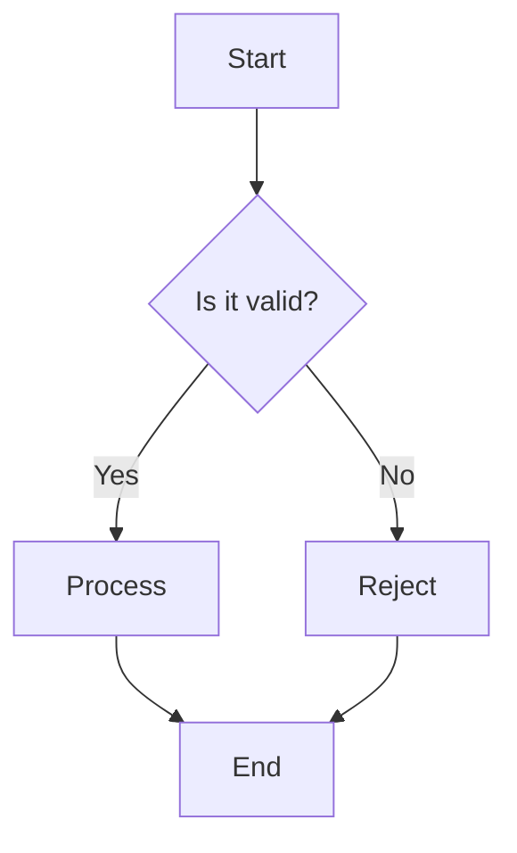

### [MMD-002] Flowchart, left-right

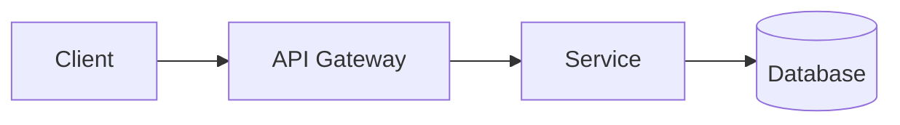

### [MMD-003] Flowchart directions BT and RL

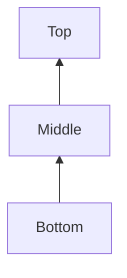

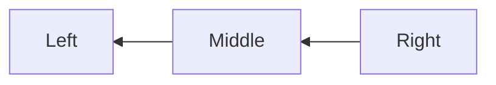

### [MMD-004] Flowchart node shapes

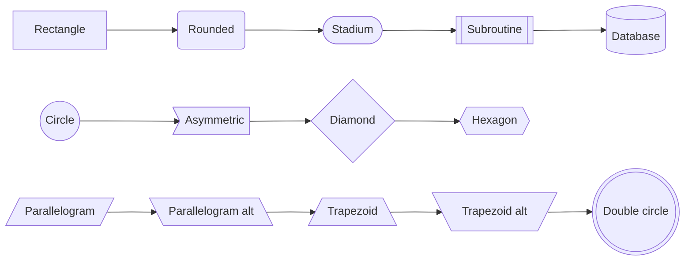

### [MMD-005] Flowchart edge types

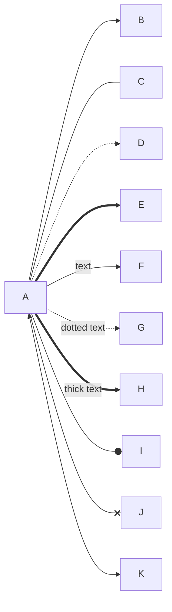

### [MMD-006] Flowchart subgraphs

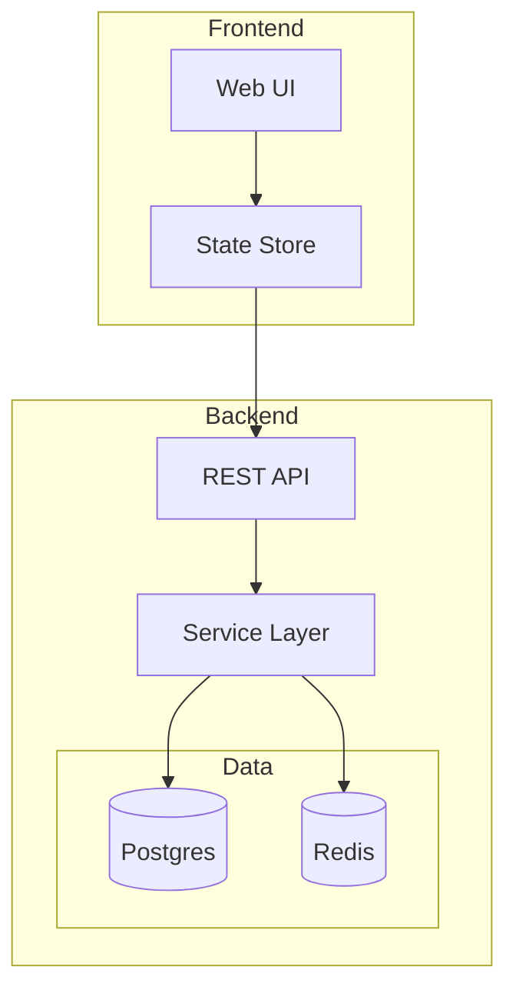

### [MMD-007] Flowchart styling

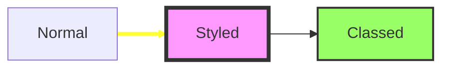

### [MMD-008] Flowchart with long and special-character labels

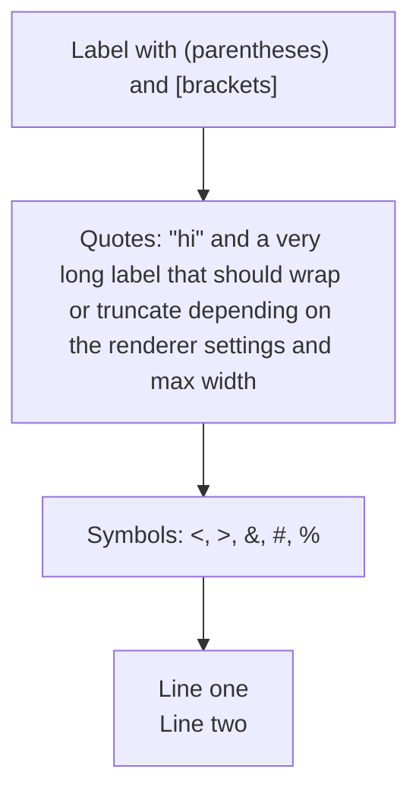

### [MMD-009] Flowchart, larger graph (20 nodes)

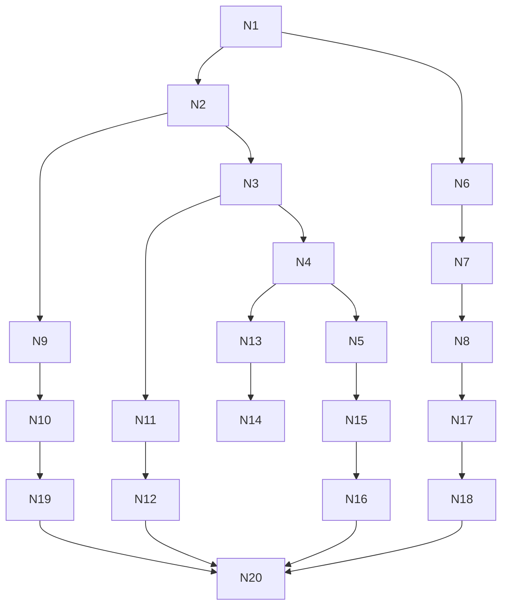

### [MMD-010] Sequence diagram

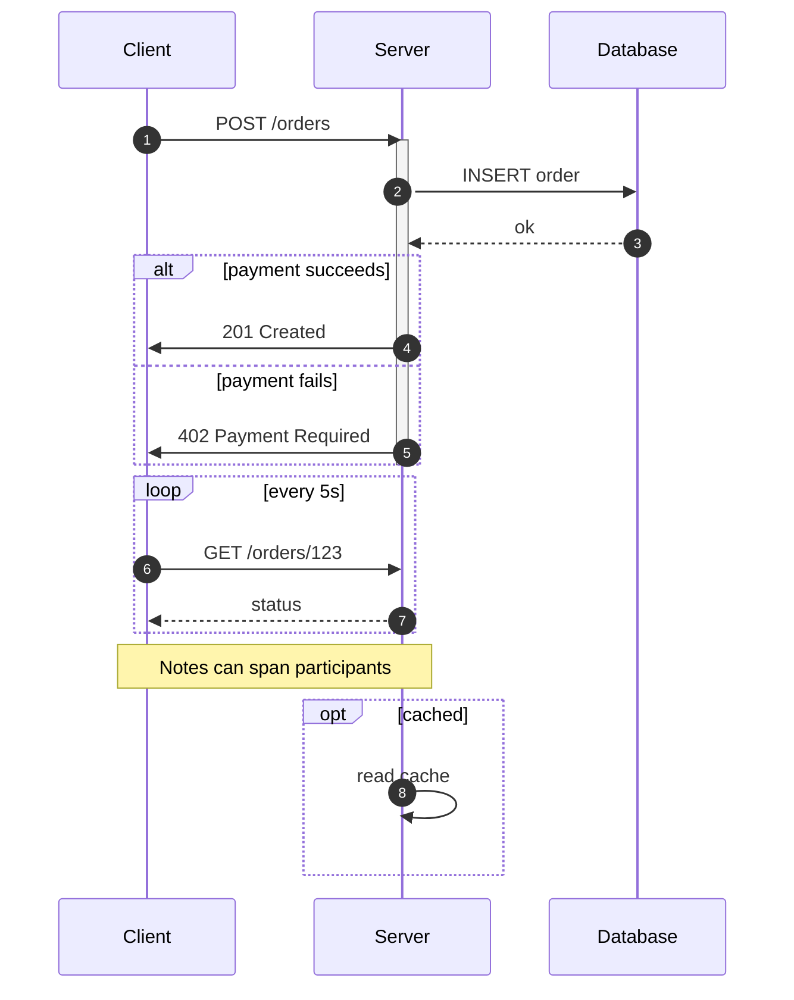

### [MMD-011] Class diagram

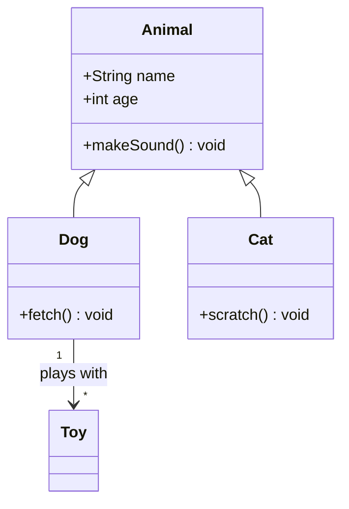

### [MMD-012] State diagram

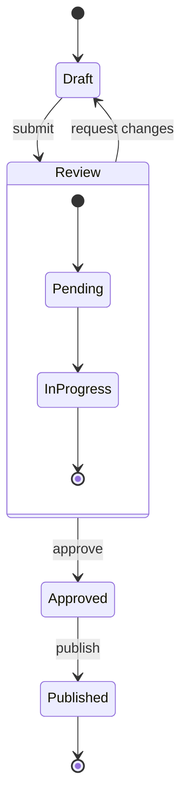

### [MMD-013] Entity-relationship diagram

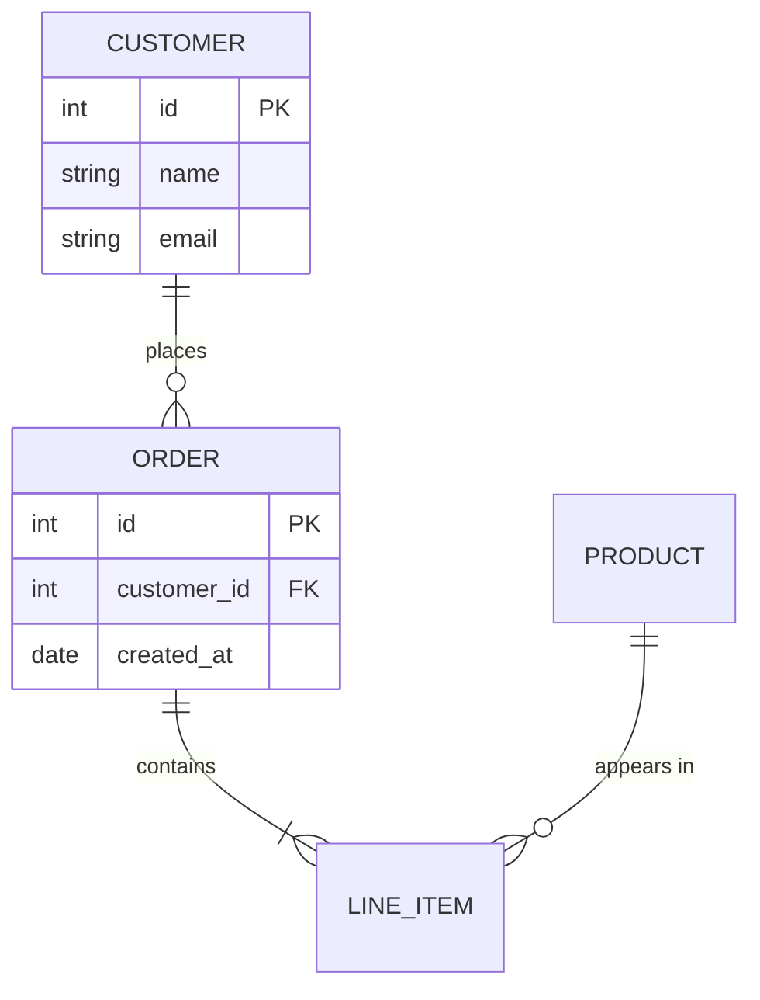

### [MMD-014] Gantt chart

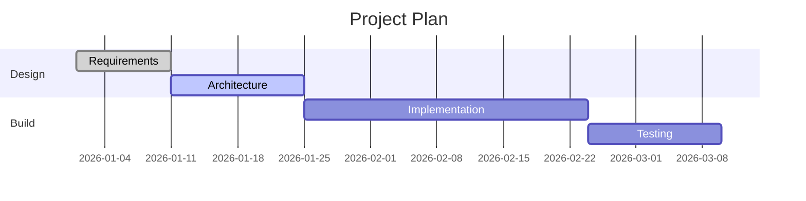

### [MMD-015] Pie chart

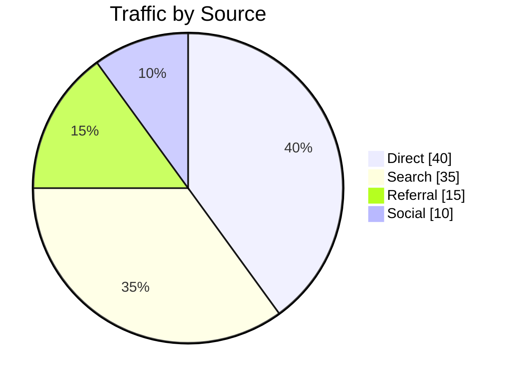

### [MMD-016] Git graph

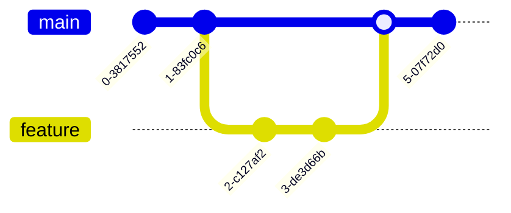

### [MMD-017] Mindmap

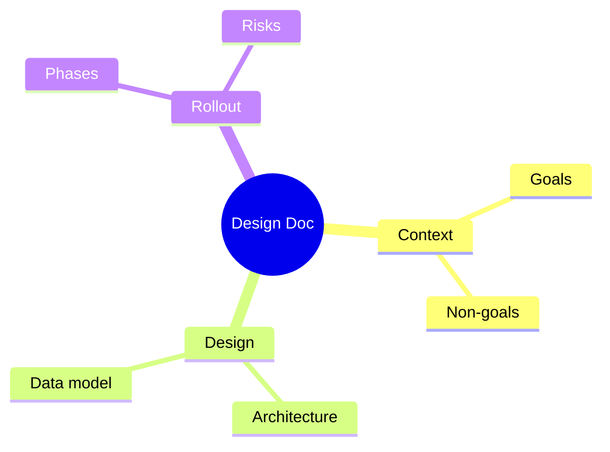

### [MMD-018] Timeline

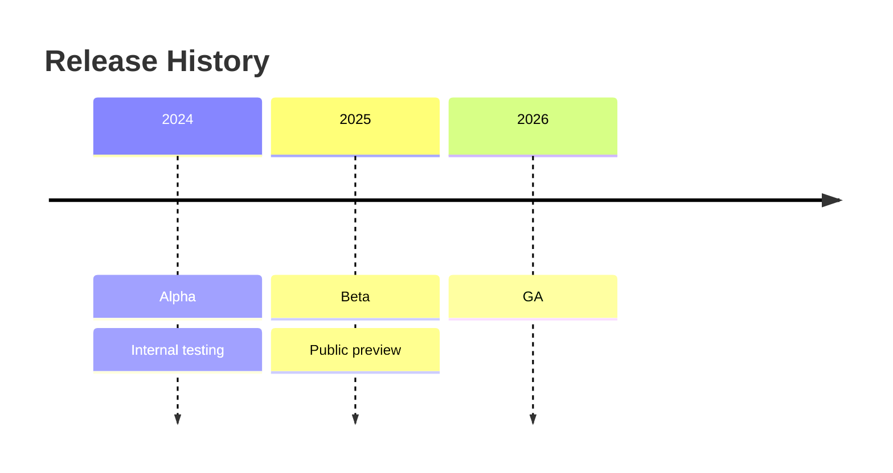

### [MMD-019] User journey

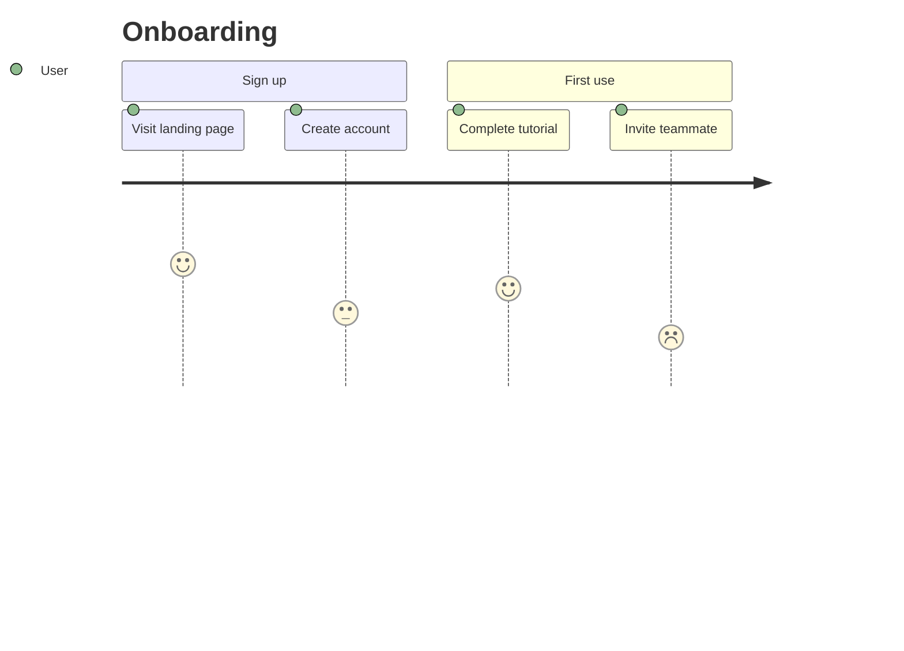

### [MMD-020] Init directive and themes

```mermaid
%%{init: {"theme": "dark", "flowchart": {"curve": "linear"}}}%%
flowchart LR
    A[Dark themed] --> B[Linear edges]
```

```mermaid
%%{init: {"theme": "forest"}}%%
flowchart LR
    A[Forest themed] --> B[Diagram]
```

### [MMD-021] Frontmatter config

```mermaid
---
title: Diagram with frontmatter title
config:
  theme: neutral
---
flowchart LR
    A --> B --> C
```

### [MMD-022] Comments in diagram

```mermaid
flowchart LR
    %% this is a comment
    A --> B
    %% another comment
    B --> C
```

### [MMD-023] Syntax error (INVALID)

```mermaid
flowchart TD
    A --> --> B
    this is not valid mermaid syntax {{{
```

### [MMD-024] Unknown diagram type (INVALID)

```mermaid
notADiagramType
    A --> B
```

### [MMD-025] Empty mermaid block (EDGE)

```mermaid
```

### [MMD-026] Mermaid with only whitespace (EDGE)

```mermaid


```

### [MMD-027] Multiple diagrams back to back

```mermaid
flowchart LR
    A --> B
```
```mermaid
flowchart LR
    C --> D
```
```mermaid
flowchart LR
    E --> F
```

### [MMD-028] Mermaid fence variants

~~~mermaid
flowchart LR
    A[Tilde fenced] --> B[Still mermaid]
~~~

````mermaid
flowchart LR
    A[Four-backtick fenced] --> B[Still mermaid]
````

```Mermaid
flowchart LR
    A[Capitalized language tag] --> B[Case sensitive?]
```

```mermaid title="attrs"
flowchart LR
    A[With extra info-string attributes] --> B[Still mermaid?]
```

### [MMD-029] Mermaid shown as code, not rendered (via nesting)

````markdown
```mermaid
flowchart LR
    A[This should show as source] --> B[Not be rendered]
```
````

### [MMD-030] Mermaid in a list item

1. First, look at this diagram:

   ```mermaid
   flowchart LR
       A[In list] --> B[Level 1]
   ```

2. Then this one:

   ```mermaid
   sequenceDiagram
       A->>B: from a list item
   ```

### [MMD-031] Mermaid in nested list, 3 levels

- level 1
  - level 2
    - level 3 with diagram:

      ```mermaid
      flowchart TD
          X[Deep] --> Y[Nesting]
      ```

    - level 3 sibling
  - level 2 sibling

### [MMD-032] Mermaid in ordered, then bullet, then alpha

1. Step one
   - Detail with diagram:

     ```mermaid
     flowchart LR
         A --> B
     ```

2. Step two
   a. Alpha detail with diagram:

      ```mermaid
      flowchart LR
          C --> D
      ```

### [MMD-033] Mermaid in a table cell (EDGE)

| Diagram | Notes |
|---------|-------|
| `flowchart LR; A --> B` | inline code only, fenced blocks cannot live in a cell |

### [MMD-034] Mermaid in a blockquote and alert

> [!NOTE]
> Diagram inside an alert:
>
> ```mermaid
> flowchart LR
>     A[Alert] --> B[Diagram]
> ```

### [MMD-035] Mermaid with text before and after, no blank lines

Text immediately before
```mermaid
flowchart LR
    A --> B
```
Text immediately after

### [MMD-036] Mermaid with markdown-significant labels

```mermaid
flowchart LR
    A["**bold** label"] --> B["`markdown string`"]
    B --> C["_italic_ and *italic*"]
```

### [MMD-037] Very wide diagram

```mermaid
flowchart LR
    A1 --> A2 --> A3 --> A4 --> A5 --> A6 --> A7 --> A8 --> A9 --> A10 --> A11 --> A12 --> A13 --> A14 --> A15 --> A16 --> A17 --> A18 --> A19 --> A20
```

### [MMD-038] Very tall diagram

```mermaid
flowchart TD
    A1 --> A2 --> A3 --> A4 --> A5 --> A6 --> A7 --> A8 --> A9 --> A10 --> A11 --> A12 --> A13 --> A14 --> A15 --> A16 --> A17 --> A18 --> A19 --> A20
```

### [MMD-040] Architecture-style flowchart as used in design docs

```mermaid
flowchart LR
    subgraph Clients
        Web[Web App]
        Mobile[Mobile App]
    end
    subgraph Edge
        LB[Load Balancer]
        GW[API Gateway]
    end
    subgraph Services
        Auth[Auth Service]
        Orders[Order Service]
        Billing[Billing Service]
    end
    subgraph Storage
        PG[(PostgreSQL)]
        S3[(Object Store)]
        MQ{{Message Queue}}
    end
    Web --> LB
    Mobile --> LB
    LB --> GW
    GW --> Auth
    GW --> Orders
    Orders --> PG
    Orders --> MQ
    MQ --> Billing
    Billing --> PG
    Billing --> S3
```

---

## 24. Cross-component combinations

### [COMBO-001] Ordered list, bullet children, code under bullets

1. Set up the environment
   - Install dependencies:

     ```bash
     npm install
     ```

   - Configure the environment:

     ```bash
     cp .env.example .env
     ```

2. Run the service
   - Start it:

     ```bash
     npm start
     ```

   - Verify it:

     ```bash
     curl localhost:3000/health
     ```

### [COMBO-002] Three-level mixed, with code at every level

1. Top-level step

   ```bash
   echo "top"
   ```

   - Middle bullet

     ```bash
     echo "middle"
     ```

     1. Inner numbered step

        ```bash
        echo "inner"
        ```

     2. Inner numbered step two
   - Middle bullet two
2. Top-level step two

### [COMBO-003] Alphanumeric outline with prose, code, and diagram

1. Phase one: Discovery

   a. Gather requirements:

      - Interview stakeholders
      - Review existing docs

   b. Draft the architecture:

      ```mermaid
      flowchart LR
          A[Requirements] --> B[Draft] --> C[Review]
      ```

2. Phase two: Build

   a. Implement the core:

      ```python
      class Core:
          def run(self):
              pass
      ```

   b. Add tests:

      i. Unit tests
      ii. Integration tests

### [COMBO-004] Blockquote with list, code, table, and mermaid

> **Design decision**
>
> 1. We choose option A because:
>    - It is simpler
>    - It is faster
>
> 2. Example:
>
>    ```python
>    result = option_a()
>    ```
>
> | Option | Cost |
> |--------|------|
> | A      | Low  |
> | B      | High |
>
> ```mermaid
> flowchart LR
>     A[Option A] --> B[Chosen]
> ```

### [COMBO-005] List item containing table, then code, then math

- Complexity analysis:

  | Algorithm | Time | Space |
  |-----------|------|-------|
  | Merge sort | $O(n \log n)$ | $O(n)$ |
  | Quick sort | $O(n \log n)$ avg | $O(\log n)$ |

  Reference implementation:

  ```python
  def merge_sort(xs):
      if len(xs) <= 1:
          return xs
      mid = len(xs) // 2
      return merge(merge_sort(xs[:mid]), merge_sort(xs[mid:]))
  ```

  Recurrence:

  $$
  T(n) = 2T(n/2) + O(n)
  $$

### [COMBO-006] Tasks containing nested ordered lists with code

- [ ] Migrate the database
  1. Take a backup:

     ```bash
     pg_dump mydb > backup.sql
     ```

  2. Run the migration:

     ```bash
     ./migrate up
     ```

- [x] Update the docs
  - [x] README
  - [ ] Runbook

### [COMBO-007] Alert containing a nested list with code and a table

> [!IMPORTANT]
> Rollout checklist:
>
> 1. Enable the flag:
>
>    ```bash
>    flagctl enable new-flow
>    ```
>
> 2. Watch these metrics:
>
>    | Metric | Threshold |
>    |--------|-----------|
>    | p99 latency | < 200ms |
>    | error rate | < 0.1% |

### [COMBO-008] Bold-and-code-heavy list (common in design docs)

- **`GET /items`**: returns a paginated list
  - **Query params**: `limit` (default `20`), `cursor`
  - **Response**: `200 OK` with `{ "items": [...], "next": "..." }`
- **`POST /items`**: creates an item
  - **Body**: `{ "name": string, "tags": string[] }`
  - **Response**: `201 Created`
  - **Errors**:
    - `400`: invalid body
    - `409`: duplicate name

### [COMBO-009] Heading, list, rule, quote repeated without blank lines (EDGE)

## Heading
- item
---
> quote
## Heading again
1. ordered
***
text

### [COMBO-010] Same-line combinations

- > quote inside bullet inside list
1. - bullet inside ordered on one line
> - bullet in quote on one line
> 1. ordered in quote on one line
> > - bullet in nested quote

### [COMBO-011] Emphasis, code, link, math all in one paragraph

This paragraph has **bold**, *italic*, ~~strike~~, `code`, a [link](https://example.com), an image , math $x^2$, and a bare URL https://example.com all in one line.

### [COMBO-012] Heading followed immediately by each block type (no blank lines)

## Heading then list
- item
## Heading then code
```
code
```
## Heading then table
| A | B |
|---|---|
| 1 | 2 |
## Heading then quote
> quote
## Heading then rule
---
## Heading then math
$$
x = 1
$$

### [COMBO-013] Fenced-code-looking content inside list text (EDGE)

- Item with inline fence-like text: ```not a fence```
- Item with inline triple backticks ``` in the middle of a line
- Item that is just three backticks and text ```python

### [COMBO-014] Markdown that documents markdown (nested fences)

````markdown
# Example document

- list item
  ```python
  print("nested")
  ```

> [!NOTE]
> An alert

| A | B |
|---|---|
| 1 | 2 |

```mermaid
flowchart LR
    A --> B
```
````

---

## 25. Edge cases and robustness

### [EDGE-001] Adjacent block elements without blank lines

# Heading
Paragraph directly after heading.
> Quote directly after paragraph.
- List directly after quote.
```
code directly after list
```
Paragraph directly after code.
---
Text directly after rule.

### [EDGE-002] Trailing whitespace variants

Line with one trailing space 
Line with two trailing spaces  
Line with three trailing spaces   
Line with no trailing space

### [EDGE-003] Tabs in various positions

Text	with	tabs	between	words.

-	bullet with tab after marker
-	second bullet with tab after marker

1.	ordered with tab after marker
2.	second ordered with tab after marker

>	quote with tab after marker

### [EDGE-004] Many unclosed emphasis markers (pathological)

*a *b *c *d *e *f *g *h *i *j *k *l *m *n *o *p *q *r *s *t *u *v *w *x *y *z

**a **b **c **d **e **f **g **h **i **j **k **l **m **n **o **p **q **r **s **t

_a _b _c _d _e _f _g _h _i _j _k _l _m _n _o _p _q _r _s _t

### [EDGE-005] Many unclosed brackets (pathological)

[a [b [c [d [e [f [g [h [i [j [k [l [m [n [o [p [q [r [s [t


` `` ``` ```` ````` `````` ``````` ````````

`a `b `c `d `e `f `g `h `i `j `k `l `m `n `o `p

### [EDGE-007] Deeply nested blockquotes (12 levels)

> 1
> > 2
> > > 3
> > > > 4
> > > > > 5
> > > > > > 6
> > > > > > > 7
> > > > > > > > 8
> > > > > > > > > 9
> > > > > > > > > > 10
> > > > > > > > > > > 11
> > > > > > > > > > > > 12

### [EDGE-008] Very long unbroken word

Supercalifragilisticexpialidocious_Supercalifragilisticexpialidocious_Supercalifragilisticexpialidocious_Supercalifragilisticexpialidocious_Supercalifragilisticexpialidocious_Supercalifragilisticexpialidocious

### [EDGE-009] Very long URL in prose and in link

https://example.com/a/very/long/path/that/keeps/going/and/going/and/going/and/going/and/going/and/going/and/going/and/going/and/going/and/going/and/going?with=a&very=long&query=string&that=also&keeps=going&and=going&and=going

[https://example.com/a/very/long/link/text/that/is/also/the/visible/label/of/the/link/and/keeps/going/and/going/and/going](https://example.com)

### [EDGE-010] Line starting with symbols that look like markdown

+ plus at the start
- minus at the start
* star at the start
> greater at the start
# hash at the start
1. number at the start
| pipe at the start
$ dollar at the start
` backtick at the start
~ tilde at the start
= equals at the start
: colon at the start

### [EDGE-011] Link reference definitions in odd places

[def-a]: https://example.com/a

Text between definitions.

[def-b]: https://example.com/b "Title B"

[def-c]:
    https://example.com/c
    "Title on next line"

Uses [def-a], [def-b], and [def-c].

- [def-in-list]: https://example.com/list

Uses [def-in-list] after being defined in a list item.

### [EDGE-012] Paragraph that looks like a table but is not

| not | a table |
| because | there is no delimiter row |

a | b
c | d

### [EDGE-013] Entities and escapes next to formatting

**&amp;bold&amp;** and *&lt;italic&gt;* and `&amp;code&amp;`

\**not bold but italic?*\*

\`not code\` and `real code` in the same line

### [EDGE-014] Consecutive horizontal rules and headings

---
---
---
# H1
## H2
---
### H3
---

### [EDGE-015] Setext heading with multi-line text (EDGE)

Line one of the heading
line two of the heading
=======================

Another multi-line
setext H2
----------

### [EDGE-016] List then setext-looking underline (EDGE)

- item
---

- item
===

### [EDGE-017] Numbered paragraph vs list at start of line (EDGE)

2026. A year at the start of a sentence reads like a list marker.

1986\. Escaped to avoid the list.

### [EDGE-018] Blank-looking lines with whitespace only

Paragraph before.
   
	
Paragraph after whitespace-only lines.

### [EDGE-019] Form-feed-free long separators

======================================================================

----------------------------------------------------------------------

**********************************************************************

### [EDGE-020] Document ending without a trailing newline follows (see next case)

The case below is the final case in the file.

---

## 26. Realistic design document (end-to-end sample)

### [DOC-001] Full sample design doc

# Design Doc: Order Processing Redesign

> [!NOTE]
> Status: **Draft**. Owner: platform team. Last updated 2026-11-20.

## 1. Context and goals

The current order pipeline has three problems:

1. **Latency.** p99 is above $T_{\max} = 800\,\text{ms}$ during peak load.
2. **Coupling.** Billing and inventory are called synchronously from the order handler.
3. **Observability.** There is no single trace across services.

### 1.1 Goals

- Reduce p99 latency below 300 ms.
- Decouple billing and inventory via events.
- Add end-to-end tracing.

### 1.2 Non-goals

- Replacing the payment provider.
- Changing the public API shape.

## 2. Proposed architecture

```mermaid
flowchart LR
    Client --> GW[API Gateway]
    GW --> Orders[Order Service]
    Orders -->|OrderCreated| MQ{{Event Bus}}
    MQ --> Billing[Billing Service]
    MQ --> Inventory[Inventory Service]
    Orders --> DB[(Orders DB)]
```

### 2.1 Request flow

1. The client sends `POST /v1/orders`.
2. The gateway authenticates and forwards the request.
3. The order service:
   a. Validates the payload.
   b. Writes the order in state `PENDING`:

      ```sql
      INSERT INTO orders (id, customer_id, state, created_at)
      VALUES ($1, $2, 'PENDING', NOW());
      ```

   c. Publishes `OrderCreated`:

      ```json
      {
        "type": "OrderCreated",
        "orderId": "ord_123",
        "customerId": "cus_456",
        "items": [{ "sku": "A1", "qty": 2 }]
      }
      ```

4. Billing and inventory consume the event independently.
   - If billing fails, the order moves to `PAYMENT_FAILED`.
   - If inventory fails, the order moves to `BACKORDERED`.

### 2.2 State machine

```mermaid
stateDiagram-v2
    [*] --> PENDING
    PENDING --> PAID : billing ok
    PENDING --> PAYMENT_FAILED : billing failed
    PAID --> FULFILLED : inventory ok
    PAID --> BACKORDERED : inventory failed
    FULFILLED --> [*]
```

## 3. API changes

| Endpoint | Method | Change | Breaking |
|----------|:------:|--------|:--------:|
| `/v1/orders` | `POST` | Returns `202 Accepted` | Yes |
| `/v1/orders/{id}` | `GET` | Adds `state` field | No |
| `/v1/orders/{id}/events` | `GET` | New endpoint | No |

> [!WARNING]
> Changing `POST /v1/orders` from `201` to `202` is a breaking change. Clients must poll or subscribe for completion.

## 4. Capacity estimate

Given arrival rate $\lambda$ and service rate $\mu$, utilization is

$$
\rho = \frac{\lambda}{\mu}
$$

For $\lambda = 400$ req/s and $\mu = 500$ req/s, $\rho = 0.8$.

## 5. Rollout plan

- [x] Design review
- [ ] Implement event publishing
  - [ ] Add outbox table
  - [ ] Add publisher worker
- [ ] Shadow traffic for one week
- [ ] Cut over

```bash
# Enable the new flow for 5% of traffic
flagctl set new-order-flow --percent 5
```

## 6. Open questions

1. Do we need exactly-once delivery, or is at-least-once with idempotent consumers enough?
2. Which tracing backend do we standardize on?
   - Option A: OpenTelemetry collector with a hosted backend
   - Option B: Self-hosted Jaeger

See also the [rollout runbook](./runbook.md) and [capacity notes](#4-capacity-estimate).

---

*End of fixture.*

---

## 27. Unterminated constructs (MUST BE LAST IN FILE)

An unterminated top-level fence swallows the rest of the document by design, so it lives at the very end where it cannot disturb earlier cases. Two more cases of this kind cannot coexist in one live file and should be run as standalone inputs:

- Unclosed mermaid fence: a ```` ```mermaid ```` opener with `flowchart LR` and `A --> B`, followed by a paragraph and no closing fence.
- Unclosed block math: a `$$` opener with one line of text and no closing `$$`.


### [FENCE-020] Unclosed backtick fence (EDGE)

```python
this fence is never closed
so everything to the end of the document is code
